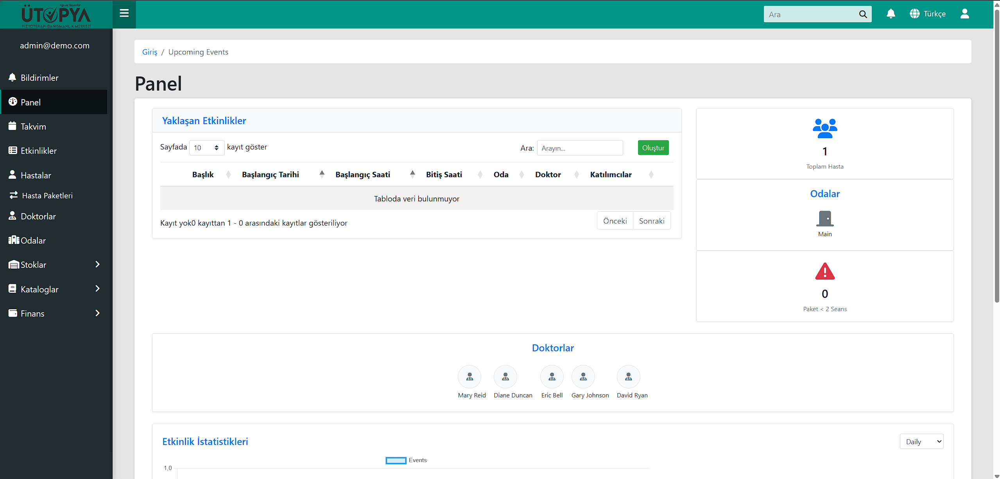
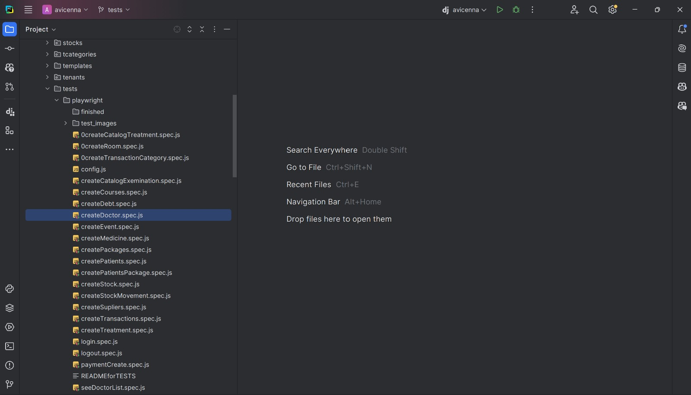

# Utopia Playwright Tests

Utopia için Playwright ile yazılmış uçtan uca testler bu depoda bulunur. Uygulama özel olduğu için paylaşılmamıştır; testler uygulamanın yapısını ve otomasyon yaklaşımını göstermek içindir.

## Test kapsamı

`app/tests/playwright/` altındaki testler giriş/çıkış, kayıt oluşturma ve güncelleme, listeleme, form alanları ve görsel yükleme akışlarını kapsar. Onarım bekleyen `app/tests/waiting for repair/` testleri varsayılan çalıştırmaya dahil değildir.

`0` ile başlayan üç test (`0createCatalogTreatment`, `0createRoom`, `0createTransactionCategory`) sonraki akışların ihtiyaç duyduğu katalog, oda ve işlem kategorisi verilerini hazırlar. Playwright yapılandırması test dosyalarını tek worker ile çalıştırdığı için bu alfabetik ön ekli hazırlık testleri diğer testlerden önce çalışır.

## Kurulum

1. Node.js kurun.
2. Bağımlılıkları ve Playwright tarayıcılarını kurun:

   ```sh
   npm install
   npx playwright install
   ```

3. `.env.example` dosyasını `.env` olarak kopyalayın ve kendi test ortamınıza göre düzenleyin:

   ```env
   BASE_URL=http://localhost:8000
   TEST_USERNAME=test-user@example.com
   TEST_PASSWORD=replace-with-a-test-password
   ```

   `TEST_USERNAME` ve `TEST_PASSWORD` yalnızca test hesabına ait olmalıdır. Gerçek veya tekrar kullanılan parolaları depoya eklemeyin.

## Testleri çalıştırma

```sh
npm test
```

Belirli bir testi çalıştırmak için:

```sh
npx playwright test app/tests/playwright/login.spec.js
```

Test çalıştırması terminalde sonuçları listeler ve HTML raporunu `playwright-report/` klasörüne yazar. Raporu açmak için:

```sh
npm run test:report
```

## Görseller

Aşağıdaki dosyalar arayüz/test dosyalarına ilişkin örnek görsellerdir; test çalıştırma sonucu veya başarılı test kanıtı değildir.




---

# Utopia Playwright Tests (English)

This repository contains Playwright end-to-end tests for Utopia. The application is private and is not included; the tests are shared to demonstrate its structure and the automation approach.

## Coverage

Tests under `app/tests/playwright/` cover login/logout, record creation and updates, list views, form fields, and image uploads. Tests under `app/tests/waiting for repair/` are excluded from the default run until repaired.

The three `0`-prefixed tests (`0createCatalogTreatment`, `0createRoom`, and `0createTransactionCategory`) prepare catalog, room, and transaction-category data required by subsequent flows. The Playwright configuration uses a single worker, so these alphabetically prefixed setup tests run before the other test files.

## Setup

1. Install Node.js.
2. Install dependencies and Playwright browsers:

   ```sh
   npm install
   npx playwright install
   ```

3. Copy `.env.example` to `.env` and update it for your test environment:

   ```env
   BASE_URL=http://localhost:8000
   TEST_USERNAME=test-user@example.com
   TEST_PASSWORD=replace-with-a-test-password
   ```

   Use credentials created specifically for testing. Do not commit real or reused passwords.

## Run tests

```sh
npm test
```

Run one test:

```sh
npx playwright test app/tests/playwright/login.spec.js
```

The run prints results in the terminal and writes an HTML report to `playwright-report/`. Open it with:

```sh
npm run test:report
```

## Images

The images below are examples of the interface and test files, not evidence of a test run or passing tests.


